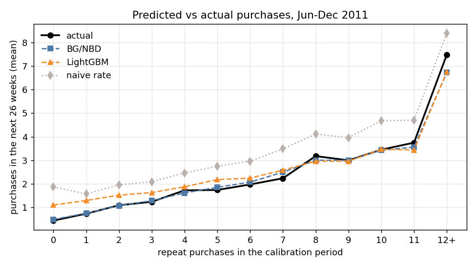
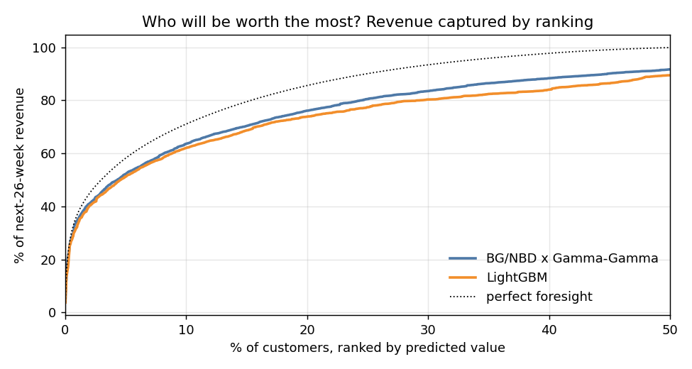
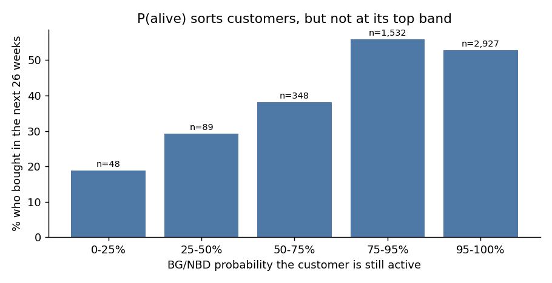
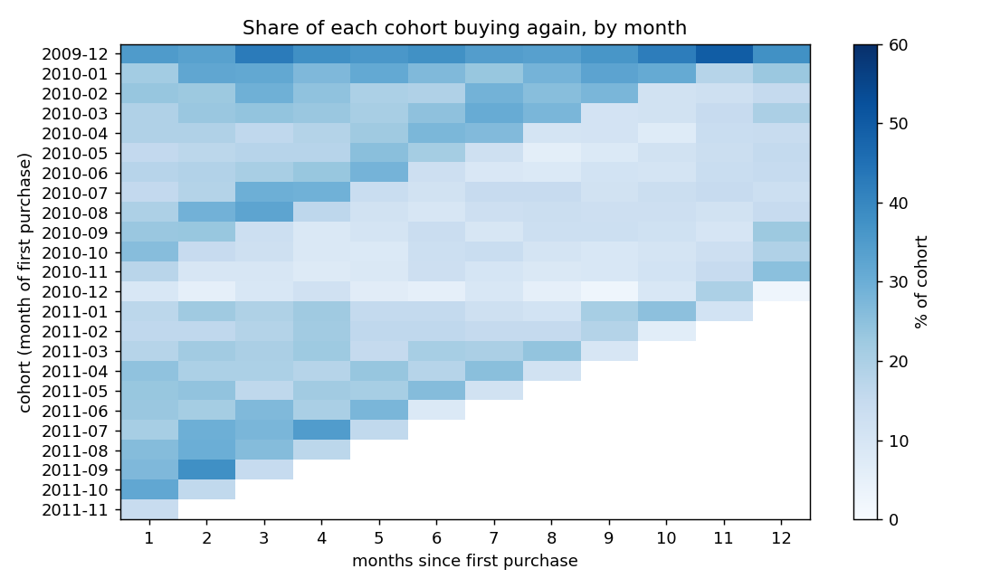

[[English](README.md) ] | [Español ]

# Valor de vida del cliente: predecir los próximos seis meses de cada cliente


Dos años de transacciones reales (diciembre de 2009 a diciembre de 2011) de un mayorista online
de artículos de regalo del Reino Unido: 1,07 millones de líneas de factura y 5.878 clientes
identificados. El 10% de los clientes genera el 64% de los ingresos, así que la pregunta útil es
**quiénes valdrán más a continuación**, y cuánto puede esperar el negocio de su base actual.

Ajusto los modelos clásicos de "compra hasta que te vas": BG/NBD para el número de compras y
Gamma-Gamma para el gasto, implementados desde sus verosimilitudes con scipy. Los evalúo de forma
honesta: calibro con todo lo anterior al 10 de junio de 2011, predigo las 26 semanas siguientes y
comparo con lo que cada cliente hizo realmente.

## Resultados

Período de prueba: 10 de junio al 9 de diciembre de 2011, 4.944 clientes.

| Modelo | Error del total de compras | MAE por cliente | Spearman | Ingresos del 10% mejor rankeado | Error del ingreso total |
|---|---|---|---|---|---|
| Ingenuo: tasa pasada x 26 semanas | +68% | 1,67 | 0,56 | 60% | +39% |
| LightGBM, variables RFM de ventana fija | +24% | 1,26 | 0,53 | 62% | +15% |
| **BG/NBD x Gamma-Gamma** | **-2%** | **1,04** | **0,62** | **64%** | -13% |



**Tres números por cliente bastan.** BG/NBD solo ve cuántas veces compró el cliente, cuándo compró
por última vez y hace cuánto es cliente. Predice el total de compras con un error de 2% y sigue el
comportamiento real en todos los niveles de frecuencia. La tasa ingenua supone que nadie se va y se
excede en dos tercios.

**El baseline de machine learning necesitó una corrección para que la comparación fuera justa.**
Tiene que entrenarse en un período anterior con resultados conocidos (variables hasta junio de 2010
y objetivo las 26 semanas siguientes, la misma temporada). Mi primera versión usaba totales
históricos como variables y se excedía en 151%: en junio de 2010 los datos tenían seis meses, en
junio de 2011 dieciocho, así que los totales quedaban muy fuera de lo que el modelo había visto.
Reconstruir las variables con ventanas fijas de 13 y 26 semanas bajó el error a 24%. Aun así
ordena a los clientes un poco peor que BG/NBD, con mucha más maquinaria.

**Los ingresos se subestiman un 13%.** El período de prueba incluye el peak de Navidad y los modelos
son estacionarios; el gasto por pedido en el segundo semestre fue mayor que en el período de
calibración.



Para focalizar acciones importa más el orden que los totales: el 10% de clientes mejor rankeado por
BG/NBD x Gamma-Gamma aportó el 64% de los ingresos de los seis meses siguientes, frente a 62% de
LightGBM y 60% de la tasa ingenua.

### Dos cosas que los modelos hacen mal, y por qué



**P(alive) acierta en el orden pero falla arriba.** Los clientes con 50-75% de probabilidad de
seguir activos volvieron a comprar el 38% de las veces; los de 75-95%, el 56%. Pero la banda más
alta (95-100%) volvió solo el 53%, porque contiene 1.607 clientes de una sola compra: en BG/NBD un
cliente solo puede abandonar después de una recompra, así que quien compró una vez está "vivo" por
construcción. Solo el 26% de ellos volvió, frente al 85% de los recurrentes de la misma banda. Para
reactivación, los clientes de una sola compra necesitan su propia regla.

**El gasto y la frecuencia son casi independientes** (correlación 0,13 entre recurrentes), que es el
supuesto que necesita Gamma-Gamma; aquí se cumple razonablemente.

## Cohortes



Los clientes captados entre septiembre y diciembre de 2010 volvieron a comprar en los meses 2 a 6 a
la mitad de la tasa del resto de las cohortes (10,7% frente a 21,2%). Con un solo año de datos no se
puede separar "los clientes de temporada navideña valen menos" del calendario: sus meses 2 a 6 caen
en la temporada baja de enero a mayo. La fila de diciembre de 2009 está inflada porque incluye a
todos los clientes que ya existían cuando empiezan los datos, y el último mes observado (diciembre
de 2011) tiene solo nueve días.

## Método

```
online_retail_II.csv ──► clientes identificados, sin cancelaciones, solo productos reales,
                          facturas agrupadas por día de compra (data.py)
        │
        ├── resumen al corte: x (días de recompra), t_x, T, gasto promedio; compras e ingresos del período de prueba
        ├── BG/NBD y Gamma-Gamma por máxima verosimilitud (btyd.py, scipy)
        ├── baselines: tasa ingenua; LightGBM con RFM de ventana fija, entrenado un año antes
        └── comparación en el período de prueba, revisión de P(alive), retención por cohorte (evaluate.py)
```

La implementación se prueba contra simulaciones del propio modelo: recupera los parámetros de
clientes simulados, y la esperanza condicional para el período de prueba coincide con las compras
futuras simuladas dentro de 5% en total y de 10% en compradores frecuentes y recientes.

## Datos

Online Retail II, Daqing Chen, UCI Machine Learning Repository (2019). Copia en Kaggle
[mashlyn/online-retail-ii-uci](https://www.kaggle.com/datasets/mashlyn/online-retail-ii-uci),
licencia CC0. Descargado en octubre de 2026; no se redistribuye aquí.

## Reproducir

```powershell
python -m venv venv
.\venv\Scripts\python.exe -m pip install -r requirements.txt
$env:PYTHONPATH = "src"
python -m clv.evaluate      # descarga con ~/.kaggle/kaggle.json la primera vez
python -m clv.figures
pytest -q tests
```

## Limitaciones

- Los clientes son sobre todo empresas que compran al por mayor, y se comportan distinto a
  consumidores.
- Los modelos no tienen estacionalidad; una covariable o un ajuste estacional atacaría la brecha
  de ingresos.
- Un solo corte calibración/prueba. Un segundo corte unos meses antes mostraría cuán estable es el
  ranking.

## Licencia

Código: MIT. Datos: CC0 (copia en Kaggle del dataset de UCI), no se redistribuyen.
